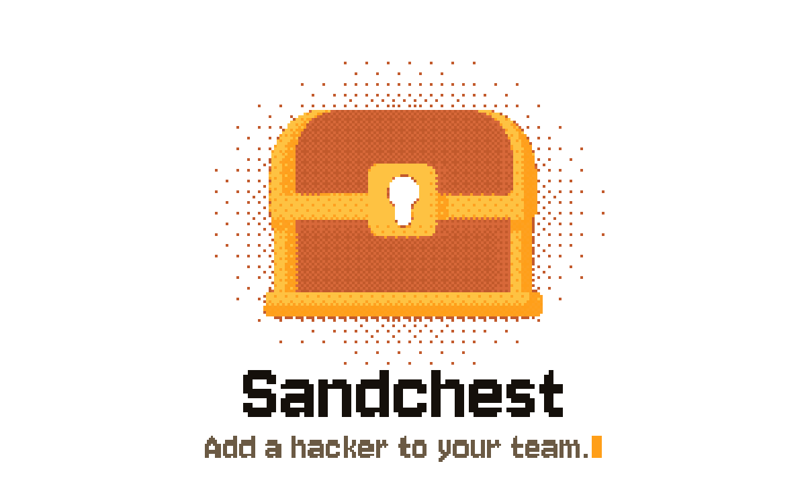

<p align="center">
  <a href="https://www.sandchest.com">
    <picture>
      <source media="(prefers-color-scheme: dark)" srcset=".github/readme/hero-dark.png">
      
    </picture>
  </a>
</p>

<p align="center">
  <a href="https://www.sandchest.com">Website</a>
  &nbsp;·&nbsp;
  <a href="https://www.sandchest.com/docs">Docs</a>
  &nbsp;·&nbsp;
  <a href="docker#readme">Self-host</a>
</p>

<br>

## What is Sandchest

Sandchest acts like a real hacker embedded in your team, using abliterated, unrestricted models to find real vulnerabilities in your code before attackers do.

Attackers already use these models to scan code for holes. Sandchest runs the same models on your repos and sends you what it finds. Install the GitHub App, pick the repos it can see, and it gets to work.

- **It maps every repo** into a threat model, with the entry points, auth checks, sensitive data and dangerous code an attacker would look for first
- **It reviews every pull request** and puts what it finds on the exact lines, so new holes don't make it to main
- **It deep scans a whole repo** when you ask, with several attacker agents hunting through all of it at once
- **It checks your fixes** each time you push to the default branch, and closes a finding once its attack path is gone

It only reports what it can prove. Every finding names the way in, walks the path through your code by file and line, says who can exploit it and what they get, and comes with a proof of concept. Then it tells you what the fix has to guarantee and hands you a prompt to paste into your coding agent, regression test included.

<picture>
  <source media="(prefers-color-scheme: dark)" srcset=".github/readme/finding-dark.svg">
  
</picture>

Use the hosted version at [sandchest.com](https://www.sandchest.com) or run the whole thing on your own server. It's open source under AGPL-3.0, and a self-hosted install sends nothing to us.

## How it works

### It maps your code

Pick the repos it can see. Before it tries anything it learns each one the way an attacker would, every route and auth check and data store and dangerous call. That map is its threat model, and every scan starts from it.

<picture>
  <source media="(prefers-color-scheme: dark)" srcset=".github/readme/step-map-dark.svg">
  
</picture>

### It hunts through all of it

A deep scan sends several attacker agents through your code at once. One thinks like an outsider, one like a free user who wants everything, one like a fraudster, one like an insider whose access never got revoked. They follow untrusted input from every entry point to the code it can hurt.

Then a skeptic tries to prove each finding wrong. It can only throw one out by pointing at the code that stops the attack, so what's left is real.

<picture>
  <source media="(prefers-color-scheme: dark)" srcset=".github/readme/step-hunt-dark.svg">
  
</picture>

### It reviews every pull request

New code gets the same treatment. Findings land on the exact lines as review comments, each with a fix prompt for your agent. Push the fix and Sandchest checks again, and once the attack path is gone the finding closes itself. On public repos the details stay in your dashboard and the pull request only gets a check.

<picture>
  <source media="(prefers-color-scheme: dark)" srcset=".github/readme/step-review-dark.svg">
  
</picture>

## Why abliterated models

Attackers don't use the polite version of a model. They download an open-weight one and abliterate it.

Researchers found that a model's refusals come from a single direction inside it. Find that direction, remove it from the weights, and the model stops saying no. It's every bit as capable as before. It just doesn't hedge anymore. That's what people scanning your code for holes are running right now, so it's what Sandchest runs too.

<picture>
  <source media="(prefers-color-scheme: dark)" srcset=".github/readme/models-dark.svg">
  
</picture>

Ask a stock model how to break into your app and you get advice. Ask an abliterated one and you get the request that works. Sandchest's hunters are told they're attackers holding your source code, and they act like it. They chain small bugs into account takeovers, race the checkout, stack the coupons and write the proof of concept. A softened finding is a missed one.

The only difference between Sandchest and the real thing is where the results go.

- It only reads repos you install it on
- It never runs your code or the exploits it writes
- Findings go only to people who can push to the repo
- Your code is treated as untrusted, so a comment telling it to look away gets reported instead of obeyed

## Use it from your agent

Everything works from Claude Code, Cursor, Codex or any agent: setting up, paying, deep scans, findings, fix prompts and settings. Press **Set up with your agent** on [sandchest.com](https://www.sandchest.com) and paste the prompt into your agent, or add the MCP server yourself:

```sh
claude mcp add --transport http sandchest https://www.sandchest.com/api/mcp
```

Agents without MCP use the same tools over HTTP (`/api/v1`, with a device-flow sign-in). You approve the agent once in your browser; a first card payment is the only other step it hands back to you. See [Use it from your agent](https://www.sandchest.com/docs/agents).

## Self-hosting

Sandchest is open source and runs on your own server with Docker. A self-hosted install has no plans or credits and sends nothing to us. Your code only goes to GitHub and to the model endpoint you choose.

```sh
git clone https://github.com/CapSoftware/Sandchest.git
cd Sandchest/docker
cp .env.example .env     # your address, two secrets and a model endpoint
docker compose up -d --build
docker compose logs web | grep setup
```

Open the link it prints and Sandchest creates its own GitHub App in one click. You need a machine with 2 CPUs and 4 GB of memory, a public HTTPS address for GitHub's webhooks, and a model endpoint that speaks chat completions with tool calls and strict JSON output. Sandchest is tuned for a fast abliterated model, and one model does every job.

The [full guide](docker#readme) covers tunnels, reverse proxies, every setting, upgrades, backups and troubleshooting.

## Development

It's a Bun workspace with the Next.js app in `apps/web`, shared code in `packages/*` and the Rust indexer in `crates/indexer`. `docker/compose.dev.yml` starts a Postgres for development.

The images in this README come from `bun run readme` in `apps/web`.

```sh
bun install
docker compose -f docker/compose.dev.yml up -d
bun run indexer:build
bunx turbo run typecheck
bun test
```

## Licence

AGPL-3.0. The Sandchest name and logo are trademarks and aren't covered by the licence. [TRADEMARKS.md](TRADEMARKS.md) has the details.
